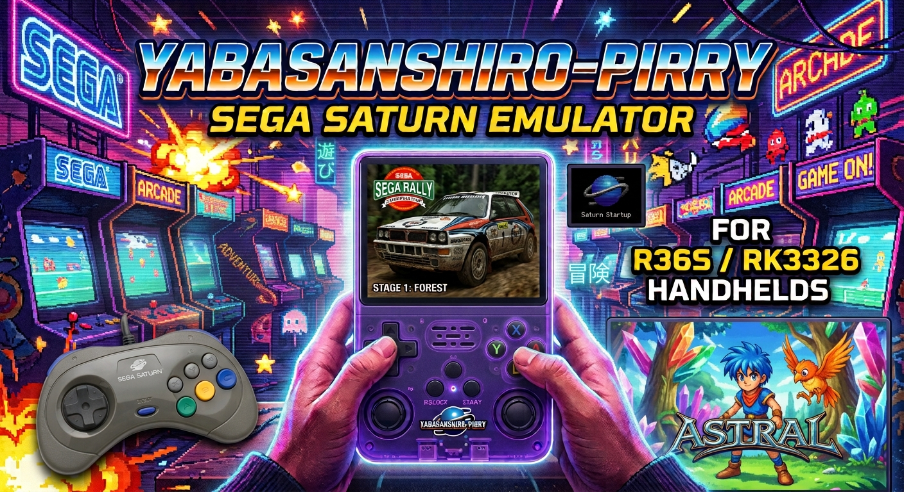

# yabasanshiro-pirry — Sega Saturn for the R36S

A heavily optimized build of **Yaba Sanshiro** for R36S-class handhelds
(RK3326: Cortex-A35 CPU, Mali-G31 GPU).

For the past few months I've been working almost every day on one thing:
getting Sega Saturn emulation on the R36S to run as fast and as cleanly as
this little handheld allows.

The Saturn is famously hard to emulate: two SH-2 CPUs, two video chips, a
separate sound CPU with its own DSP, and a CD subsystem — all of which have to
stay in sync. On a Cortex-A35 that is a real squeeze. Out of the box, many games
were too slow, had broken graphics, FMV or sound, or froze outright.

So instead of just tweaking settings, I went into the emulator itself. I
profiled it on the device, found where the time actually goes, and fixed or
rewrote those parts. Every change was measured game by game
with recorded inputs and save states, and only kept if it made things faster or
more correct **without breaking anything else**.

## What's in this build

**Over 100 games tested and tuned on the R36S.**

- **Speed** — improvements in the CPU emulation and the video code
- **Stability** — fixes for games that froze, crashed or wouldn't boot
- **Graphics** — fixes for missing layers, flickering and broken effects
- **Sound** — fixes for missing effects, stutter and wrong volume balance
- **Multi-disc games** — launch them via a `.m3u` playlist (one entry in EmulationStation, starts with disc 1); switch discs with **Next Disc** in the menu (use BIOS)
- **Interlace speed-up (optional)** — high-resolution games can draw their backgrounds at half height: up to **+39 % speed** (Battle Arena Toshinden URA), backgrounds slightly less sharp. Off by default, switch it on per game in the menu.
- **No per-game hacks** — every fix applies to all games

## Controls

- **Select** opens the in-game menu
- **Select + Start** quits the game
- In the menu, **A** selects and **B** goes back
- Your button layout is taken over automatically from EmulationStation on first start

## In-game menu (press Select)

Settings you change here are **saved per game** — every game keeps its own.

**Sound Settings** *(new)*

| Setting | Options | What it does |
|---|---|---|
| **CD Music** | 0 – 150 % (steps of 25) | Volume of the CD audio music. **0 turns the CD music off**, sound effects and voices keep playing. |
| **Sound Effects** | 0 – 150 % (steps of 25) | Volume of sound effects and voices (the Saturn sound chip). |
| **DSP** | Off (default) / On | Off: less heat, no reverb/echo. On: reverb and echo effects like on the real console, runs about 2–5 °C hotter. |

Use **Left / Right** to change a value.

> **Music is not always CD music.** Many Saturn games stream their music as
> CD audio — then it follows **CD Music**. But a lot of games play their music
> through the Saturn's own sound chip, just like the sound effects — then it
> follows **Sound Effects**, and the CD Music setting does nothing. If turning
> CD Music down doesn't change the music, try Sound Effects instead.

**Other settings**

| Setting | What it does |
|---|---|
| **System Language** *(new)* | English, Deutsch, Français, Español, Italiano, Japanese — the language the game sees (takes effect when the game restarts) |
| **Show/Hide FPS** | FPS counter on/off |
| **Enable/Disable Frame Skip** | Skip drawing frames to keep the game at full speed |
| **Save State / Load State** | Quick save and load |
| **Next Disc** *(new)* / **Open CD Tray** | Change discs in multi-disc games (use BIOS) |
| **Resolution** | Native, 4x, 2x, **Original**, 720p, 1080p — all testing was done with **Original** |
| **Aspect rate** | Original, 4:3, 16:9 |
| **Interlace — Half-height backgrounds** *(new)* | **Off by default.** Only for high-resolution (interlaced) games: backgrounds are drawn at half height, which makes these games noticeably faster (Battle Arena Toshinden URA +39 %, D-Xhird +23 % in my tests). Backgrounds look slightly less sharp, characters and 3D are not affected. Takes effect immediately, saved per game. |
| **Use compute shader** | **On by default in this build.** On: rotating backgrounds are drawn by the GPU. Off: they are drawn by the CPU. All testing was done with it on. |
| **Reset** | Restart the game |
| **RetroAchievements** *(new)* | Login / Logout, **Achievements** (list of the running game), **Mode** (Softcore / Hardcore), **Indicators** (On / Off) — see [RetroAchievements](#retroachievements) |
| **About** *(new)* | Version, credits, licenses, privacy note, links to the source code and this page |

## RetroAchievements

yabasanshiro-pirry supports [RetroAchievements](https://retroachievements.org).

- **Log in** — Select → RetroAchievements → Login, enter user name and password with the on-screen keyboard.
  The password is used once; after that only a login token is stored on the device
  (`~/.yabasanshiro/retroachievements.cfg`). **Logout** removes it.
  You can also create that file yourself with a `username=` and a `password=` line.
- **Achievements** — Select → RetroAchievements → Achievements shows the list of the running game:
  unlocked ones first with a green check, locked ones in grey, with points, description and progress.
- **Hardcore mode** — Mode: Hardcore. Load State is disabled in hardcore. Switching *to* hardcore needs a
  restart of the game: a red **Reset** button appears next to Mode, press it. Switching back to Softcore works
  at once. The message at game start shows the mode.
- **Leaderboards** run in hardcore mode. Live values, challenge and progress indicators appear at the top right —
  turn that box off with **Indicators: Off** (unlock messages stay).
- Only disc versions known to RetroAchievements are supported — many European discs are not.
- **Note:** RetroAchievements accepts hardcore unlocks only from approved emulators. Until this build is approved
  you will see a "Warning: Unknown Emulator" message in hardcore; softcore works normally.
- **Privacy:** nothing is sent unless you log in. Then your user name, your password (first login only), the
  game's disc hash, your unlocks and the game status go to retroachievements.org. No other server, no telemetry.

## Requirements

- R36S or another RK3326 handheld (R35S, K36 and similar clones)
- **dArkOS** (Debian trixie based). The build needs glibc 2.38 or newer —
  check with `ldd --version`.
  **ArkOS** (Ubuntu based). The build needs glibc 2.29 or newer —
    check with `ldd --version`.
  
- For RetroAchievements: **libcurl** (`libcurl.so.4`, included in dArkOS). Without it the emulator runs as
  before, only RetroAchievements is not available.


## How to install (installer script)

  The installer works on **dArkOS** and **ArkOS**. It detects the system by itself.

  **1. Download the right build for your system**

  Both builds are on the [Releases page](https://github.com/pirrypirrypirry/yabasanshiro-pirry-release/releases) — pick the one for your OS:

  - **dArkOS**: the dArkOS build (needs glibc 2.38 or newer)
  - **ArkOS**: the ArkOS build (needs glibc 2.29 or newer)

  Not sure which one you have? Run `ldd --version`.

  **2. Copy two files to the SD card**

  Put `install_yabasanshiro_pirry.sh` and `yabasanshiro-pirry` **next to each other** in
  `roms/tools/` (on the card with your games).

  **3. Run the installer**

  On the handheld, open **Tools → install_yabasanshiro_pirry**. It can also be started from a
  terminal: `sudo bash /roms/tools/install_yabasanshiro_pirry.sh`

  Every step is shown with `[ OK ]` or `[FAIL]`. When it is done, EmulationStation restarts by itself.

  **4. Choose the emulator**

  For the Saturn system (or for a single game) pick **standalone-pirry-nobios**,
  or **standalone-pirry-bios** if you have a BIOS file in `roms/bios/`.

  **What the installer changes**

  - copies the emulator to `/opt/yabasanshiro/yabasanshiro-pirry`
  - adds a `pirry` entry to `/usr/local/bin/saturn.sh`
  - adds the two emulators to `/etc/emulationstation/es_systems.cfg`

  The original Yaba Sanshiro stays untouched. Both files are backed up first (`*.backup`), and
  running the installer again is harmless. A log is saved next to the script
  (`install_yabasanshiro_pirry.log`).

  **Uninstall:** restore the backups:

  ```bash
  sudo cp -p /usr/local/bin/saturn.sh.backup /usr/local/bin/saturn.sh
  sudo cp -p /etc/emulationstation/es_systems.cfg.backup /etc/emulationstation/es_systems.cfg
  ```


## Manual Installation

**1. Copy the emulator**

```bash
cp yabasanshiro-pirry /opt/yabasanshiro/yabasanshiro-pirry
chmod +x /opt/yabasanshiro/yabasanshiro-pirry
```

**2. Back up the two files you are going to edit**

```bash
sudo cp -p /usr/local/bin/saturn.sh /usr/local/bin/saturn.sh.backup
cp -p /etc/emulationstation/es_systems.cfg /etc/emulationstation/es_systems.cfg.backup
```

**3. `/usr/local/bin/saturn.sh`** — inside the block `if [[ $1 == *"standalone"* ]]`,
add this branch next to the other standalone variants:

```bash
  elif [[ $1 == *"pirry"* ]]; then
    YABA_BIN="./yabasanshiro-pirry"
    if [[ ! -d "/$directory/saturn/yabasanshiro-pirry" ]]; then
      mkdir /$directory/saturn/yabasanshiro-pirry
    fi
```

In the BIOS check further down, skip the "BIOS missing" warning for this
build (it finds the BIOS by itself) by adding `&& [[ $1 != *"pirry"* ]]`:

```bash
    if [[ ! -f "/$directory/bios/saturn_bios.bin" ]] && [[ $1 != *"pirry"* ]]; then
```

Check the syntax: `bash -n /usr/local/bin/saturn.sh` (no output = OK).

**4. `/etc/emulationstation/es_systems.cfg`** — add two emulators to the
`<emulators>` section of the Saturn system:

```xml
			<emulator name="standalone-pirry-nobios">
			</emulator>
			<emulator name="standalone-pirry-bios">
			</emulator>
```

The names must contain `standalone` and `pirry`, plus `-bios` or `-nobios` —
`saturn.sh` decides by the name. Check: `grep -c 'standalone-pirry' /etc/emulationstation/es_systems.cfg` → `2`.

**5. Restart EmulationStation** (`sudo systemctl restart emulationstation`) and
pick **standalone-pirry-nobios** or **standalone-pirry-bios** as the emulator —
for the whole Saturn system or per game. The existing Yaba Sanshiro entries
stay untouched.

**6. BIOS** (optional): put `saturn_bios.bin` into `/roms/bios/`. Use the
`-bios` emulator for games that need it and for multi-disc games.

## Tips

- **BIOS:** most games run without it. Some games need it, and **multi-disc
  games** should be played with BIOS.
- **Multi-disc games:** put the discs in a subfolder and add a `.m3u` file next
  to it that lists the disc files, one per line, e.g.
  `Grandia/Grandia (Disc 1).chd`. Hide the single discs in EmulationStation if
  you like.
- **Old save states:** save states made with other builds or older versions
  can cause missing sound or freezes. If a game behaves strangely after
  loading a save state, start fresh and make a new one.
- **DSP (Sound Settings):** off by default — less heat and full speed. Turn it
  on if a game sounds wrong without reverb/echo effects. It runs slightly hotter
  (about 2–5 °C).

## Test setup

All testing and all FPS values in the game list were done in **performance
mode** — CPU, GPU and RAM governors set to `performance`:

| | Clock |
|---|---|
| CPU (Cortex-A35) | 1512 MHz |
| GPU (Mali-G31) | 600 MHz |
| RAM (DDR) | 924 MHz |

With power-saving governors (e.g. `ondemand`) the clocks drop and the games
run slower than listed. For the best result, use performance mode. Keep an
eye on the temperature — when the device gets too hot, it throttles itself.

## Known limitations

- Heavy 3D games do not reach full speed on this hardware — it's as fast as
  the RK3326 gets, not a locked 60.
- Not every game has been tested. If one gives you trouble, open an issue
  with the game name and what happens.

## Still in progress

I'm still optimizing the emulator — speed, accuracy and more games. New builds
will follow, so check back for updates. Feedback and game reports are welcome:
open an issue with the game name and what happens.

## License and source code

yabasanshiro-pirry is based on **Yaba Sanshiro** by devMiyax and on
**Yabause**, and is licensed under the **GNU General Public License v2**.

All credit for the original emulator goes to devMiyax and the Yabause team.

## SOURCE CODE

https://github.com/pirrypirrypirry/yabasanshiro-pirry
